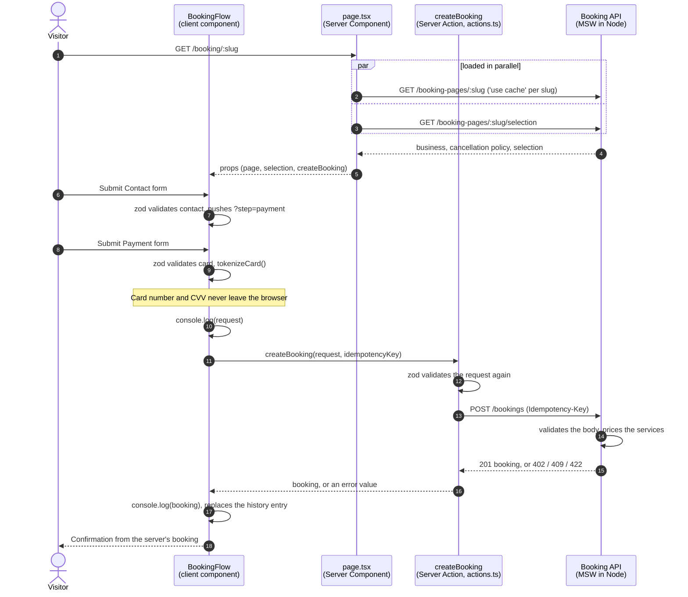

# Moxie booking flow

A public booking page in three steps, **Contact → Payment → Confirmation**, built from the Figma design with Next.js (App Router), React 19, and TypeScript.

- **Hosted page:** https://moxie-take-home-tau.vercel.app/booking/gold-spa (Vercel, with the mock API running in the server)
- **Repository:** https://github.com/5h1rU/moxie-take-home

The page opens on `/booking/gold-spa`. `/booking/glow-med-spa` is a second business with different data (no logo, another timezone, another cancellation policy), which shows that nothing about the business is hardcoded.

## Setup instructions

Requires Node 22.12+ and pnpm.

```bash
pnpm install
pnpm dev        # http://localhost:3000
```

No environment setup is needed: the mock booking API runs inside the Next.js server by default. `.env.example` documents the two settings (`API_MOCKING=disabled` turns the mock off, `API_URL` points at a real API).

| Command | What it does |
| --- | --- |
| `pnpm test` | Vitest + Testing Library: schemas, the Server Action, and the full flow |
| `pnpm typecheck` | Generates route types, then runs `tsc` |
| `pnpm lint` | ESLint, including the styling and import boundaries described below |
| `pnpm build && pnpm start` | Production build; the mock API runs in it too |

On the final submit, the browser console shows **`Booking request`** (the object the page sends) and **`Booking confirmed`** (what the server answered). The server logs the mock API's responses as `[mock api] …`.

### Try the failure paths

| Input | Result |
| --- | --- |
| Card `4242 4242 4242 4242`, any future expiry, CVV `123` | Booked |
| Card `4000 0000 0000 0002` | Card declined (402): error under the card number |
| Card `4000 0000 0000 0119` | Server error (500): "Something went wrong" alert; retrying keeps your input |
| Email `slot-taken@example.com` | Time no longer available (409): alert |
| Amex `3782 822463 10005` | Needs a 4-digit CVV |
| Refresh on Payment, or open `?step=payment` directly | Back to Contact (nothing is persisted, by design) |
| `/booking/anything-else` | "We couldn't find this business" |

## How it works



- **The page loads data, the Server Action submits it.** `page.tsx` loads the business and the visitor's selection on the server and hands plain props to one client component. The browser never calls the API directly: it calls the Server Action, which calls the API (a backend-for-frontend).
- **The backend is mocked with [MSW](https://mswjs.io) inside the Next.js server** (`src/instrumentation.ts`), not in the browser, because every API call happens on the server. The API base URL is a fake domain: the app makes real `fetch` calls, and MSW answers them with realistic latency and status codes. Tests use the same handlers.
- **Nothing about the business is hardcoded in components.** Name, logo, address, email, phone, timezone, and the cancellation policy (text, fee, version) come from `GET /booking-pages/:slug`. The services, provider, and time come from a fixture standing in for the earlier booking steps this exercise doesn't include. Prices, durations, and dates are formatted from cents, minutes, and ISO timestamps, and the time is shown in the business's timezone.
- **One contract, validated three times.** `src/lib/types.ts` holds zod schemas for the API. The browser validates the forms, the Server Action validates the request again (it's a public endpoint), and the mock backend validates the body and prices the services itself. The request sends ids, never prices.
- **Forms are native.** Each step is a `<form action>` with `useActionState`, read through `FormData`, with uncontrolled inputs. `useFormStatus` drives the pending button. Errors show on submit, focus jumps to the first invalid field, and a field's error clears as you edit it. Expected server failures come back as values, not exceptions, so the form keeps what you typed.
- **Card data never leaves the browser.** `tokenizeCard()` stands in for Stripe Elements: the request, the logs, and the server only see a payment-method token, brand, last 4 digits, expiry, and billing zip. The request's payment object is strict, so a payment that carries a card number or CVV is rejected.
- **Retries are safe.** Each booking attempt carries an `Idempotency-Key`, and the mock returns the same booking for a repeated key.
- **The step lives in the URL** (`?step=payment`), so browser back and forward work; the entered data lives only in memory. After booking, the history entry is replaced so Back can't reopen Payment.

### Code layout

```
src/
  app/booking/[slug]/   page, actions.ts (Server Action), loading, error, not-found
  features/booking/     BookingFlow, steps/, components/, schemas, request builder, mock tokenizer, formatting
  components/ui/        Text, Heading, Button, TextField, Checkbox, Card, Avatar, Alert, …
  components/layout/    Stack, VStack, HStack, Grid, Container, Show, BottomBar
  lib/                  API contract (zod types) and the server-only API client
  mocks/                MSW handlers and JSON fixtures for two businesses
```

**Tailwind lives only in `src/components/`.** Features and routes compose typed primitives (`<VStack gap={16}>`, `<Text tone="muted">`) and can't pass `className` or `style`. ESLint enforces this, and keeps imports flowing one way (app → features → components). Spacing props take the Figma pixel values. Swapping Tailwind out would touch one folder.

## AI usage

**Tools:** [Amp](https://ampcode.com) (coding agent, running Claude Opus) with the **Figma MCP server**. Amp ran in a cloud sandbox where it could build, test, and drive a headless browser.

**How I used them:**

- **Architecture first, code second.** Before writing any code, I worked through the decisions with Amp in a written proposal: router, where to mock, forms, styling boundaries, URL state, and card data. I made the calls and pushed back where its suggestions didn't fit:
  - It suggested treating payment as optional. Nothing in the brief or the Figma says so, so it's mandatory.
  - It suggested react-hook-form. I wanted native forms with `FormData` and actions.
  - It suggested a browser MSW worker. Every API call happens on the server, so MSW runs only in Node.
  - Tailwind came with two conditions from me: the styled components stay in an isolated folder, and there are layout primitives (Stack, VStack, HStack).
- **Figma via MCP.** Amp read design tokens, spacing, copy, and assets (the logo and the success illustration) straight from the file. I reviewed each of its design-gap calls (listed under Tradeoffs) before it built them.
- **Implementation and verification.** Amp wrote most of the code under my direction. It ran type checks, lint, tests, and a production build, and drove the app in a headless browser at 375, 768, and 1440px to compare against the Figma frames.
- **Where it was wrong.** Verification caught real bugs. For example, the first version of the "refresh on Payment returns to Contact" guard raced a state update and bounced users back after Continue; the flow test now covers it. It also used MSW 2 option names that MSW 3 renamed. When I asked it to speed up page load, it measured first and showed that the slowness came from HTTP/1.1 connection limits on the preview host, not the app, so we left the build alone.

## Assumptions

- **Payment is mandatory.** Nothing in the brief or the Figma says otherwise.
- **The card is held, not charged** ("It will not be charged now"). Deposits are out of scope.
- **The services, provider, and time are already chosen.** The Figma shows no way to pick them, so they come from a fixture that stands in for earlier booking steps.
- **US only:** 10-digit phone numbers and 5-digit zip codes.
- **"Not submitted anywhere"** is met in spirit: the booking goes from the browser to this app's own server, where the mock answers in the same process. Nothing leaves the deployment, and the object is printed to the console before the request.

## Tradeoffs

### Design gaps and the calls I made

1. **Two primary buttons on desktop Payment** (the inline "Book appointment" and the bottom bar's "Continue"). "Book appointment" is the only submit; the desktop bottom bar holds **Back** instead.
2. **No way to go back.** Added Back (bottom bar on desktop, top of the card on mobile). It keeps what you typed.
3. **No error, focus, loading, or submitting states.** Defined from the design tokens. The design has no error color, so I picked an accessible red (5.7:1 contrast on white).
4. **No tablet frame.** Two columns from 1200px, where the desktop layout fits; below that, the mobile layout in a centered column up to 720px.
5. **Confirmation differs between mobile (services card) and desktop (none).** Both now show one appointment summary (date and time, provider, services, total) built from the booking the server returned.
6. **The cancellation checkbox is a consent**, so it's required.
7. **Copy and data fixes:** "Your card will held" → "will be held". The mock phone "+11 123 4567 222" isn't a valid number, so the fixture uses a real US format. Visit reason is optional and its label says so.

### Technical decisions

- **App Router vs Pages Router.** Moxie's booking page uses the Pages Router with MUI. I used the App Router because it's the current Next.js default and its load/submit model (Server Components and Server Actions) fits this flow. Cost: Server Actions are newer, and anything that reads search params needs a Suspense boundary.
- **MSW in the server vs in the browser.** Mocking where the requests actually happen keeps the real architecture. Cost: reviewers don't see the API calls in the browser's Network tab, only the Server Action; the console and server logs make up for it. Alternatives considered: a browser service worker with client-side fetching (drops the server layer), Route Handlers as a fake backend (mock code ships as routes), plain fixtures (no real HTTP).
- **Tailwind with a small component library vs MUI.** MUI would match Moxie's stack and give accessible inputs for free, but the Figma isn't MUI's look, so most components would need overrides. The custom primitives took time but keep feature code short and close to the Figma layer tree.
- **No form library.** Two short forms don't need react-hook-form or Conform. The cost is a little code for error display rules (`useFormErrors`) and for keeping values after React resets a form on submit.
- **Validate on submit, not on blur.** Fewer interruptions while typing; errors clear as soon as a field is edited.
- **Nothing persisted.** A refresh on Payment returns to Contact. Saving contact details in session storage would be easy, but card fields must never be stored, and a half-restored form is confusing.

## Scope decisions

**In scope:** the three steps, validation, responsive layout (mobile, tablet, desktop), async submit with loading and error states, accessibility basics (labels, `aria-invalid` and `aria-describedby`, focus management, contrast), and tests for the schemas, the Server Action, and the full flow.

**Out of scope, and why:**

- **Real payments (Stripe Elements).** It needs keys and an account. `tokenizeCard()` keeps the same boundary, so it's a drop-in swap.
- **Picking services, provider, and time.** The design doesn't include those screens.
- **Persistence, i18n, analytics.** Not asked for, and each would add setup without showing more of the flow.

**With more time:** Playwright end-to-end tests and visual regression against the Figma frames, Storybook for the primitives, Stripe Elements behind `tokenizeCard()`, and a real availability check before the Payment step.

## Scope change response

> A PM pings you late in the build: "Can we add an SMS opt-in checkbox to Contact Information?"

### What would I change in the implementation?

Not much, because every layer reads from the same schemas:

- **Schema:** `contactSchema` gets `smsOptIn` (false by default), and the booking request's `consents` records it with a timestamp and the consent text version. The browser, the Server Action, and the mock backend all validate it.
- **UI:** the existing `Checkbox` goes on the Contact step, **unchecked by default**, with the consent copy.
- **Tests:** one more assertion in the flow test, checking the logged request.

### How would I communicate and handle it?

- **Ask what kind of messages first.** Payment already discloses *transactional* messages. If this is for marketing, it's a separate consent with legal weight (TCPA in the US): it must be opt-in, the copy needs legal sign-off, and it needs "Msg & data rates may apply. Reply STOP to opt out" language.
- **Ask where it belongs.** Should it appear only once a phone number is entered? Is the consent per business or for the whole platform?
- **Record the decision on the ticket.** The change is small, so the risk isn't time, it's lost context. I'd write the request, the answers to the questions above, and who approved the consent copy on the feature's Linear (or Jira) issue, not only in Slack, so whoever later asks why the checkbox exists or what users agreed to can find it.
